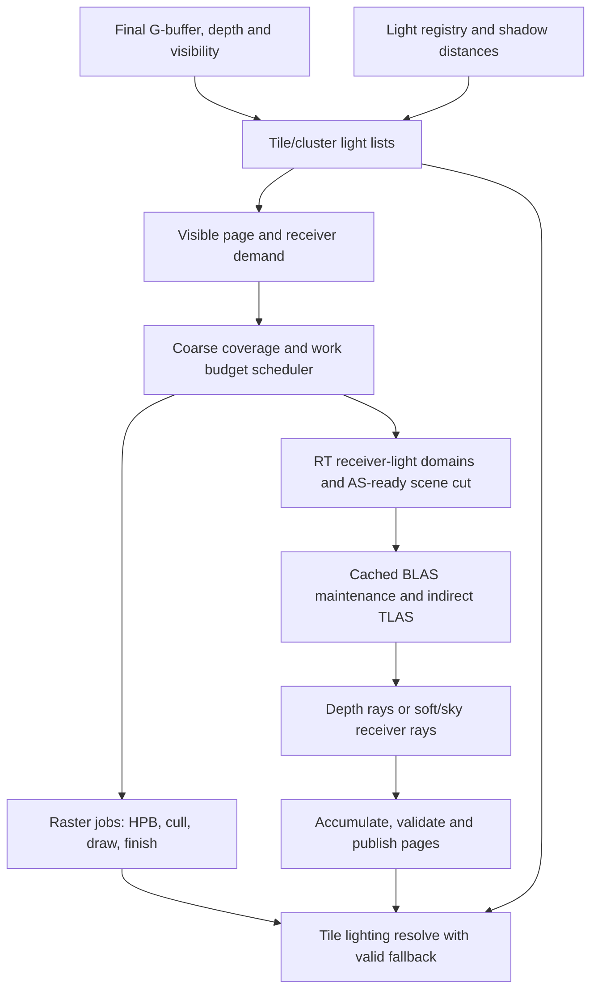

# Hybrid virtual shadow cache implementation plan

Status: implementation in progress, September 9, 2026. See the
[current implementation status](hybrid-virtual-shadow-cache-status.md). This plan extends the existing virtual shadow
map system and completes the Metal integration gates in the
[hardware ray tracing status](virtual-geometry-hardware-raytracing-status.md).
Native Vulkan acceleration structures are deferred to another session. This
document does not claim that the proposed features or their performance targets
are implemented. VSM here means **virtual shadow map**, not variance shadow map.

The proposed system has one light registry, one receiver-demand stage and one
budget scheduler, with separate page producers and typed cache payloads. Raster
and ray tracing can fill hard-light depth pages; receiver-based ray tracing
produces temporally accumulated area-light, finite-sun and sky results. Coarse
coverage remains usable while finer pages and additional samples are prepared.

## 1. Findings in the current code

| Current implementation | Consequence / proposed change |
| --- | --- |
| [VirtualShadowMapManager.hpp](../src/runtime/virtualshadowmap/VirtualShadowMapManager.hpp) defaults to 32×32 virtual pages, 128² texels/page, four directional cascades, 64 regular and 4096 future requests. | Keep sparse allocation, but distinguish queue capacity, allocations/frame, rendered pages/frame, rays/frame and bytes. Request capacity alone is not a work budget. |
| [VirtualShadowMapManager.cpp](../src/runtime/virtualshadowmap/VirtualShadowMapManager.cpp) snaps directional grids to world pages and keeps their light-depth origin stable. | Preserve that cache stability. Derive active level count from an independent shadow distance and resolution policy. |
| [vsm-common.wgsl](../assets/shaders/virtualshadowmap/wgsl/vsm-common.wgsl) selects directional levels with a distance/log2 rule; local lights already have footprint-driven perspective mip selection in [vsm-local-light-selection.wgsl](../assets/shaders/virtualshadowmap/wgsl/vsm-local-light-selection.wgsl). | Reuse the local-light footprint idea for directional resolution selection, with a common selector used by demand and resolve. Keep stable radial coverage as a constraint. |
| [vsm-bookkeeping.wgsl](../assets/shaders/virtualshadowmap/wgsl/vsm-bookkeeping.wgsl) requests a directional fallback at an offset, or the next local-light mip. Regular and fallback allocations share one dispatch and free-page pool. | A fallback request does not establish coarse-first ordering. Make coverage prerequisites and quota allocation explicit before allocation/production. |
| [vsm-shadow-mask-pcf.wgsl](../assets/shaders/virtualshadowmap/wgsl/vsm-shadow-mask-pcf.wgsl) and visible-page analysis loop over all active lights per receiver. | Build tile/cluster light lists once and reuse them before any page lookup or page request. |
| [VirtualShadowMapDrawPass.hpp](../src/runtime/virtualshadowmap/rendering/VirtualShadowMapDrawPass.hpp) owns raster HPB/culling and scratch/direct-atlas paths. | Keep HPB for raster jobs. RT jobs use the AS-ready scene and skip HPB, light-space meshlet draw lists, stencil and scratch raster. |
| [vsm-finish.wgsl](../assets/shaders/virtualshadowmap/wgsl/vsm-finish.wgsl) clears dirty pages after a successful non-overflowed draw. | RT needs separate content validity, sampling progress and convergence. Dispatch completion is not statistical convergence. |
| Light types currently cover directional, spot and point. Soft modes are Hard, PCF, PCSS and layered screen-space soft shadows. | Add emitter geometry, backend selection and accumulation settings as independent concepts. Existing PCSS/SSSS remain raster approximations. |
| Current final shadow texture contains RGB lighting plus diagnostic average visibility. | Resolve mixed light types into lighting deliberately; replacing RGB with a scalar RT hit mask would break the material contract. |

The older [system description](virtual-shadow-system.md) is useful background,
but code is authoritative: its experimental raster-mode description has drifted
from the current draw-pass enum. The new implementation should update that
description when its pass graph changes.

## 2. Light policy and cache representation

Separate these settings:

```text
LightType: Directional, Point, Spot, Rectangle, Disk, Sphere, Sky
ShadowBackend: None, RasterDepth, RayTraceDepth, RayTraceReceiver, Auto
ShadowAppearance: Hard, PhysicalSoft, RasterFiltered
ShadowQuality: texel footprint, sample/error limits, distance and work priority
```

| Light / appearance | Supported producer | Stored quantity |
| --- | --- | --- |
| Directional, point, spot; hard | RasterDepth or RayTraceDepth; optional direct receiver RT | Nearest blocker depth, or binary receiver visibility |
| Directional with angular radius; physical soft | RayTraceReceiver | Receiver-dependent integrated direct lighting / visibility statistics |
| Point/spot with finite source radius; physical soft | RayTraceReceiver | Samples of the finite emitter; a zero-radius point remains hard |
| Rectangle/disk/sphere area light | RayTraceReceiver only in this phase | Weighted direct-light samples for each receiver |
| Sky/environment | RayTraceReceiver only | Directionally integrated sky irradiance at a receiver |
| Analytical light without shadows / beyond shadow distance | None | Existing cheap unshadowed analytical lighting |

`Auto` selects only implemented, supported modes using measured cost and
hysteresis. It must not switch a point-depth map into a physical area-light
solution silently. A center-ray “hard area light” is an explicit approximation.
If hardware RT is unavailable, area/sky RT modes report unsupported and use a
declared unshadowed/coarse alternative; they do not masquerade as raster parity.

### Two different payloads are necessary

**Depth pages** remain light-space textures. Ray filling uses a closest-hit ray
per shadow texel from the directional light's projection plane, or the point/spot
origin through the projected texel, bounded to the same projection interval as
raster. Convert the hit position to exactly the raster depth convention, including
reverse-Z; miss writes the existing clear depth. The present Metal any-hit kernel
only returns visibility, so add a separate closest-hit/depth kernel. Do not store
the distance to an arbitrary first accepted hit as nearest depth.

One valid center sample completes a hard depth texel at that sampling convention.
Multiple samples can antialias coverage, but averaging nearest depths is not an
area-light shadow estimator. Raster coverage and ray-center coverage differ at
silhouettes, so parity tests need a documented edge rule or multisample reference.

**Receiver pages** hold samples evaluated at actual surfaces. A single light UV
can correspond to ground, a bridge and a wall with different area-light shadows.
Do not reuse one accumulated scalar across those surfaces. Area emitters integrate
over emitter samples, and sky lighting integrates over directions; see PBRT's
[area-light interface](https://pbr-book.org/4ed/Light_Sources/Area_Lights) and
[infinite lights](https://pbr-book.org/4ed/Light_Sources/Infinite_Area_Lights).

Use a sparse receiver-record pool attached to the virtual page directory, rather
than adding moments to every texel of the depth atlas. A record key includes:

```text
light ID + light generation + payload kind + level + unwrapped world page key
receiver object/instance generation + geometry revision + surface/chart identity
quantized surface coordinate at this level + sampling/lighting epoch
```

Construct records from the final opaque G-buffer/visibility payload, after all
raster phases and routes. Store position, geometric normal and a validation
footprint with the statistics. Start with exact selected-primitive identity and
surface coordinates; VG representation changes invalidate those receiver records.
Stable object-space surface charts can improve reuse later without weakening the
initial identity checks. A TLAS instance ID or recycled physical page slot is not
a stable receiver identity.

Group records into sparse 8×8 work blocks for dispatch and quality reduction.
Deduplicate identical keys deterministically. Distinct surfaces that land in the
same projected cell get distinct records. Hash collisions require full-key checks;
bounded record overflow remains pending or uses a compatible coarse receiver
record. It must never borrow a different surface's value. A small budgeted current
screen result pool can handle uncached receivers; otherwise use the explicit
low-confidence fallback and report the miss.

Directional/local receivers use their light clipmap/mip directory for spatial
scheduling. Sky uses a camera-centered, world-anchored sparse **3D** receiver
clipmap directory with surface records, so overhangs and interiors are represented.
It shares the allocator/scheduler contracts, but is not a fictitious single
orthographic sky depth map. Page size denotes scheduling/storage granularity;
receiver pages are not required to allocate 128² dense records.

For the first area/sky integration, accumulate incident **diffuse irradiance**
before albedo/tone mapping, with correct sample PDFs and geometric weights.
Keep diagnostic visibility separate. Multiplying analytical area lighting by
average unweighted visibility is only an approximation because visibility is
correlated with emitter direction and contribution. Exact glossy direct lighting
is view/BRDF-dependent and needs per-pixel samples or a richer directional cache;
do not claim the diffuse page cache solves it. Preserve existing analytical-light
shading and define the material integration explicitly before enabling area lights.

## 3. Distance, resolution and directional clipmaps

Expose independent settings:

```text
geometryRenderDistance
shadowReceiverDistance[quality]       // camera-to-receiver distance
shadowFadeStart / shadowFadeEnd
directionalCasterTraceDistance        // separate caster coverage policy
skyOcclusionTraceDistance             // finite approximation, separately exposed
targetShadowTexelScreenPixels         // high preset initially 1.0
maxDirectionalClipmapLevels / shadowCacheBytes
perLight.shadowReceiverDistance / influenceRange
```

A receiver outside the shadow fade end generates no VSM/RT shadow demand and
does no shadow-page lookup. It still receives cheap unshadowed analytical light
within that light's influence. Resolve uses a smooth fade such as
`Vout = lerp(Vshadow, 1, smoothstep(fadeStart, fadeEnd, cameraDistance))`.
Fade the shadowed/unshadowed irradiance estimates for area and sky instead of
pretending all lighting is a scalar visibility. `shadowReceiverDistance = 0`
disables shadow work without disabling the light.

Do not reuse this receiver cutoff as ray length or a caster camera-distance cut.
An offscreen or distant mountain can shadow a nearby receiver. Directional caster
coverage comes from the receiver volume extruded toward the emitter through a
bounded world/caster domain. Missing geometry in that domain is an incomplete
scene, not a proven ray miss. A finite caster/sky trace distance is a documented
quality approximation; a distant proxy can be a later explicit option.

Point, spot and finite area lights have bounded influence volumes. Request only
their intersection with visible receivers inside the shadow distance. Keep local
perspective mips/faces or receiver records; do not give every local light the
directional world's clipmap count. Area emitters need a configurable finite
influence cutoff even though physical inverse-square illumination has no exact
finite endpoint. That cutoff also controls the tile light test.

### Resolution rule

Let `N` be pages/axis, `P` texels/page, `E[l]` a directional level's full world
side length. Its world texel size is `t[l] = E[l] / (N*P)`.

Use the screen-to-light-plane Jacobian of the receiver footprint to choose the
**coarsest covering level** whose shadow texel footprint satisfies the quality
target. At high quality, aim for at most one internal-screen pixel per shadow
texel in both resolved tangent directions. With light-texels/screen-pixel
singular values, require `sigmaMin >= 1 / targetShadowTexelScreenPixels`.
Finite differences must stay on the same surface; reconstruct tangent derivatives
analytically or use conservative receiver bounds across depth discontinuities.
Clamp grazing degeneracies and report unmet resolution rather than allocating
unbounded pages. A cheaper max-axis footprint policy is a measured lower-quality
option, not equivalent to matching both axes.

Bootstrap `E[0]` from FOV, internal shading resolution and a reference near-receiver
depth: `worldPixel(z) ≈ 2*z*tan(fovY/2)/height`, then
`E[0] ≈ N*P*targetPixels*worldPixel(zReference)`. Treat this as initialization;
the actual receiver Jacobian and light-plane coverage decide the requested level.
For 1080p, 60° vertical FOV, `zReference=1 m`, `N=32`, `P=128`, target 1 pixel,
the initial full extent is about 4.38 m. This illustrates why a fixed 128 m first
extent cannot deliver the same close-camera resolution. It is not a universal preset.

Keep power-of-two world extents and page-snapped centers. With scale 2 and outer
receiver radius `R`, bootstrap
`levels = 1 + max(0, ceil(log2(2*R/E[0])))`, then increase until the outer level
covers `R` **after** subtracting page-snap, filter-border and transition margins.
For each receiver, also check actual light-space coverage and walk outward as
necessary. Receiver distance selects coverage/resolution; light projection depth
bounds are computed separately. The current fixed `lightDistance*2` far plane
must not silently clip casters as XY shadow distance grows.

Allocate logical level capacity up to a configured cap; activate the needed
levels per directional light without reallocating the atlas each frame. Growing
distance first produces valid outer coarse coverage; shrinking distance retires
unused pages after in-flight users finish. Keep a quantized level ladder stable
under small FOV/dynamic-resolution changes, with hysteresis before changing the
base extent or quality bias. Ordinary scrolling preserves unwrapped page identity;
projection/depth-origin changes increment its epoch.

Audit packed limits before increasing levels: current requests/physical ownership
pack the layer in 8 bits, virtual page grids are limited to 32×32, and invalidation
uses 32 row words/layer. Use explicit wider logical page/light IDs for the new
directory, or enforce a checked total-layer limit in the first migration. Do not
increase counts while allowing `layer & 0xff` to alias unrelated lights.

## 4. Tile light culling before shadow requests and resolve

Add `LightTileCullPass` before both bookkeeping and final lighting. Initially use
16×16 screen tiles; benchmark 8×8 and 16×16. Reduce opaque receiver depth bounds,
reconstruct a conservative tile frustum/AABB, and emit an empty flag for sky-only
tiles. Keep directional lights and the sky in short global lists. Test local
light spheres/cones/emitter bounds against the tile volume; refine per receiver
before page lookup. Include source radius and emitter shape in the conservative
bound. Do not use shadow receiver distance to remove unshadowed light contribution.

Use count → prefix sum → fill to create compact `(offset,count)` lists. Keep
`LightingLightList` and `ShadowEligibleLightList` distinct so distant receivers
still get analytical lights without requesting pages. Reuse lists in visible-page
analysis, receiver record generation, ray scheduling, screen-space soft-shadow
work and final resolve. The current pixel/light loop becomes pixel/tile-list work.

Start with a simple tile × local-light test as the correctness baseline. Add a
light BVH when light counts justify it; inspect the existing WorldGI light BVH
before sharing its implementation, without coupling VSM lifetime to the GI grid.
Use depth slices/occupancy masks for tiles spanning large depth discontinuities.
This progression follows the established [clustered shading approach](https://research.chalmers.se/en/publication/161725).

Overflow cannot mean silently dropping lights. Reserve a bounded global list pool
and a deterministic overflow flag; affected tiles use a slower complete-light or
BVH traversal that still filters before page access. Record its cost. Stable light
ID ordering gives reproducible work. Transparent/volumetric receivers need their
own conservative cluster lists; opaque min/max depth cannot safely cull their lights.
Normal-cone rejection is optional and disabled for two-sided/uncertain receivers.

## 5. Coarse-first coverage and deterministic scheduling

Split allocation, content production and sample refinement. A page can be
allocated without useful contents; a sampled page can be usable without converging.

```text
Absent -> AllocatedPending -> UsableCoarse/UsableNoisy -> Refining -> Stable
                                     |                   |
                                     +------ Invalidated-+
BudgetLimited is a quality flag; Retiring is a lifetime state.
```

Track validity at texel/receiver-block granularity. Keep the existing raster
dirty-bit meaning for depth pages and add separate RT state. New content is
published only after its generation and producing GPU fence match. Read and write
different history versions or serialize resolve after accumulation; never sample
half-updated statistics. Retire physical pages and their moments together.

For each visible request, find the nearest valid compatible ancestor. If none
exists, request a coarse covering page/receiver record first. Allocate/produce
those coverage jobs in an explicit stage; only the remaining quota goes to finer
levels. A valid parent need not reach its final sample target before children can
start. This avoids spending the entire budget converging the coarsest map.

Clipmaps do not form a naïve `page >> 1` tree when independently scrolled. Resolve
parents through world coordinates and each level's stable transform. Local-light
parents remain within their mip/face mapping, with seam coverage handled explicitly.
Sky parents use the 3D receiver grid. Receiver fallback additionally requires the
same compatible surface/normal/epoch; spatial proximity alone is insufficient.

Proposed scheduling classes, each ordered deterministically by quantized importance,
age, light ID, unwrapped page key and work-block ID:

1. Missing/invalid coverage of important visible receivers, coarse levels first.
2. Disoccluded receivers and changed casters/lights needing current samples.
3. Fine spatial refinement of already covered receivers.
4. Extra samples for unconverged receiver blocks.
5. Stable-history audits and bounded motion prefetch.

Reserve a small minimum service quota for each active class/light domain, with
unused quota redistributed in that order. Accumulated age prevents an expensive
sun or sky from permanently starving small lights. Require a feasible minimum
working set; if visible coarse coverage exceeds memory/work limits, retain existing
coverage, relax requested quality and expose unresolved demand. No scheduler can
promise complete first-frame coverage under an insufficient hard budget.

Expose independent limits for cache bytes, new physical pages, raster pages/draws,
BLAS build bytes/count, TLAS instances, total rays, per-light rays and stable audit
rays. Allocate exact ray ranges with prefix sums after admission. Never let every
page assume it owns the remaining global budget. Empty/converged work leaves
budget unused. Retry work counts against the same cap.

Counter-based sampling uses `(full page/receiver key, epoch, sample ordinal,
dimension, scramble)`; the ordinal advances only for valid completed samples.
Queue append order, thread scheduling and physical slot reuse cannot change it.
Use independent scrambles across temporal batches and stable reduction order.
Determinism means repeatable admitted jobs/rays for the same inputs and budgets;
it does not promise bit-identical floating-point results across GPU vendors.

GPU time varies with geometry and traversal even at fixed ray count. Treat rays
as the hard deterministic cap, and GPU milliseconds as a separately measured
target. An optional controller may adjust *next-frame* quotas from delayed timings;
record/freeze that quota sequence for deterministic benchmark replays.

## 6. Temporal accumulation and “enough rays”

**Hard shadows:** one exact opaque visibility ray completes a receiver sample for
an unchanged epoch. One closest-hit ray completes a depth texel at the center-ray
convention. Repeating identical rays adds no information. Schedule spatial edge
antialiasing separately if enabled. Changed geometry or light invalidates the result.

**Soft shadows / sky:** accumulate unbiased weighted sample contributions for a
fixed receiver and lighting epoch. Maintain sample count, mean and M2 (Welford),
sample ordinal, batch statistics, active coverage and revision tags. Counts and
moments belong to each active record/block, not just the page: thousands of samples
at one receiver do not establish that another receiver has been sampled.

At fixed batch checkpoints, estimate error and reduce to a page quality summary:

```text
sampleVariance = M2 / max(n - 1, 1)
errorIndicator ≈ safetyFactor * sqrt(sampleVariance / n)
tolerance = absoluteError + relativeError * max(abs(mean), radianceFloor)
```

For binary visibility use an interval with nonzero uncertainty at zero/all hits
(for example a conservative Wilson-based error indicator), rather than the zero
sample variance of identical Bernoulli outcomes. For weighted HDR area/sky
contributions use batch variance, minimum coverage and robust tail diagnostics;
the binary interval does not apply. Low-discrepancy/temporally correlated samples
do not make textbook independent-sample confidence formulas rigorous guarantees.
These are engineering stopping indicators, validated against high-sample truth.

A block is stable only when its receiver validation succeeds, all active records
have minimum samples and emitter/directional stratum coverage, its error indicator
passes at multiple fixed checkpoints, and no required scene data is missing.
Use a worst-important-block test plus a screen-contribution-weighted summary;
a page average must not hide a small moving penumbra or thin blocker. Keep a
nonzero stable audit quota and maximum audit interval. All-miss samples do not prove
that a small emitter occluder cannot exist.

Initial **experimental** knobs: `minSamples=16`, `maxSamples=256`, checkpoints in
batches of 4 or 8 samples, two passing checkpoints, and a target accumulation window
of 4–8 frames. Sweep these; none guarantees stabilization in eight frames. A block
that hits its sample/age/work cap while still noisy is `BudgetLimited`, not Stable.
Show filtered coarse/noisy data with confidence, keep it eligible for future work,
and report unmet quality. Resetting history every few frames just because the
window ended would prevent convergence.

Use previous completed-frame error to allocate the next deterministic batch.
For the reference mode, use a fixed sample count with no adaptive stopping.
Adaptive stopping can bias retained estimates; compare it against the reference
and, if necessary, use a separate pilot sequence for allocation/stop decisions.
Do not silently substitute clamped or temporally filtered radiance for raw moments.
History filtering/reprojection is a presentation layer and does not create new
independent samples or increment confidence.

### Invalidation and reuse

| Change | Action |
| --- | --- |
| Wrapped page reuse, receiver identity/depth/normal mismatch, disocclusion | New generation; clear statistics and coverage before publishing. |
| Caster geometry/revision, transform, BLAS readiness or shadow cut change | Invalidate receiver/depth pages whose ray domains intersect old or new caster bounds; start with conservative light-wide invalidation if dependency tracking is uncertain. |
| Emitter position/orientation/shape, sun angular radius, sampling distribution | New light/sampling epoch; reset affected receiver moments. |
| Intensity-only scalar change with unchanged sampling and geometry | Rescale irradiance mean and M2 by scale and scale²; depth/visibility stays valid. General color/texture/distribution changes require correctly represented channel moments or reset. |
| Sky texture/rotation changes | Reset sky irradiance records; geometry-only directional visibility could be reused only by a future directional representation. |
| Camera moves or clipmap scrolls | Keep records only when world/surface keys and projection epoch still match. Reprojection is validated, never based only on screen pixel or wrapped page index. |
| Quality level or VG receiver representation changes | Re-request compatible records; do not merge parent/child moments as independent samples. Parent supplies presentation fallback only. |

Moving-light/caster tests must include changes that do not overlap the receiver's
own bounds: shadow dependencies extend along the ray domain. Dynamic receivers
can use a short history or current-frame tracing when robust identity is unavailable.
Any AS-invalid ray does not enter the mean as a miss; it keeps work pending.

## 7. Soft lights and sky execution

Use receiver-to-emitter finite segments and an any-hit opaque kernel for visibility.
Bound point/spot/area rays before the sampled light surface and use geometric-normal
origin bias with scale-aware error bounds. Sun softness samples its angular disk;
area lights sample their actual shape and PDF. A zero angular/source radius has a
separate deterministic hard kernel. Group work by light, page and receiver block
for coherent rays; benchmark direct block dispatch against compacted ray lists.

For sky, sample the incoming environment over the receiver hemisphere with correct
PDFs; use environment importance and cosine sampling with a valid mixture/MIS
when useful. Accumulate incident irradiance, not a generic sky “visibility” scalar.
Uniform diffuse sky can use cosine-weighted visibility as a specialized case.
Separate an explicitly sampled sun from the environment distribution to avoid
double counting it. Sky shadowing here is direct environment occlusion, not a
replacement for multibounce GI or glossy environment reflections.

Sky has broad caster support: nearby receiver regions need a surrounding caster
domain, not just extrusion toward one light. Use a separately bounded sky queue
and coarse receiver coverage so it cannot consume all local-light/shadow work.
A short sky ray radius behaves like local ambient occlusion and misses distant
occlusion; expose that limitation through its own distance setting/reference test.

## 8. Pass graph and Metal prerequisites



The graph describes dependencies, not one submission per box. Batch native
instance conversion/TLAS/rays into as few Metal shared-event segments as possible.
Compute the ray domain from admitted jobs and conservative candidate demand; union
light domains in one scene cut where useful and benchmark separate sky subsets.
RT frames with no admitted ray jobs should skip RT-only TLAS/build work unless
there is separately budgeted asynchronous maintenance.

Complete the following existing RT gates before shipping receiver RT pages:

1. VG installation manifests, immutable geometry keys and versioned GPU handle
   tables; exported decode buffers and build dependencies; bounded BLAS install work.
2. Complete AS-ready replacement groups, retained parent geometry and in-flight
   retirement. Raw raster residency and a cached handle alone are insufficient.
3. Conservative receiver/emitter-aware offscreen hierarchy traversal and camera-
   first streaming demand merge. Sky requires its wider caster domain. No camera
   frustum, camera HZB, cone, raster-history or HPB rejection for the RT scene.
4. Extend native queries with closest-hit depth output, weighted sample metadata
   and result validity. Keep no host count readback in the frame path.
5. Finish renderer/lighting integration, invalid-scene fallback and persistent
   page/moment resources across frame slots. The current native graph bridge and
   five passing tests are the foundation, not completion of these gates.

Memory must include depth atlas, receiver records, moments, validity, ray lists,
BLAS/TLAS, scratch and retired resources. A 16384² D32 atlas alone is 1 GiB; adding
16 bytes of moments densely at that resolution would add 4 GiB. Use separate sparse
pools with measured bytes/active receiver. Do not triple-buffer the entire cache;
use versioned page updates and retain only in-flight versions. RT depth publication
may require R32 storage plus a compatible depth resolve/export path because the
current depth attachment is not automatically a writable Metal storage texture.

## 9. Implementation sequence and acceptance gates

| Phase | Concrete changes | Acceptance |
| --- | --- | --- |
| H0: policy and diagnostics | Add `ShadowLightSettings`, payload/state records, distances, budget counters and stable IDs; keep current raster output as reference. | Unsupported combinations explicit; zero shadow distance suppresses requests/lookups but preserves unshadowed light. |
| H1: tile light lists | Add `LightTileCullPass` and shared list buffers; update bookkeeping and resolve. | Image parity with full-light loop, no missing lights on overflow/depth edges, measured resolve/request cost reduction. |
| H2: clipmaps and coverage scheduler | Add `ShadowClipmapPolicy`, shared footprint selector, active level metadata, wider IDs, explicit coverage/refinement queues. | Full configured receiver-distance coverage, high-quality footprint metrics, stable scroll/FOV behavior and bounded allocations. |
| H3: Metal scene readiness | Complete installation/cut/demand/retirement gates above and extend native depth query. | Offscreen/missing-sibling/eviction tests preserve valid fallback; zero warm BLAS builds; no host waits. |
| H4: RT hard depth pages | Add `VirtualShadowMapRayTraceDepthPass`; route raster and RT jobs separately and publish compatible depth pages. | Closest-hit/raster parity on identical geometry, reverse-Z/miss/bias/point-face tests; RT jobs execute no HPB/draw work. |
| H5: receiver pages and accumulation | Add `ShadowReceiverCache`, `ShadowRaySchedulePass`, native soft kernels and `ShadowPageAccumulatePass`. | Multiple receivers at one light UV stay independent; deterministic ray caps, valid history reuse, stable/budget-limited distinction and soft-light convergence. |
| H6: sky and material resolve | Add sky receiver clipmaps, environment sampling and tile-based irradiance resolve; keep sun separate. | Uniform/HDR sky references, interiors/overhangs, finite-distance error, no double lighting or diffuse/glossy contract confusion. |
| H7: tuning and defaults | Benchmark policy/group sizes, cache bytes, adaptive allocation and long replays; expose settings/debug UI. | Quality/cost curves and p95 budgets from full renderer measurements, not isolated ray throughput. |

H1/H2 improve raster VSM independently of the Metal work. H4 provides the fastest
path to interchangeable raster/RT hard-light maps. H5/H6 add the receiver-dependent
representations needed for physical soft lights and sky. Native Vulkan AS is not
an acceptance dependency in this session.

Modify existing manager/pass/bookkeeping/finish/common/resolve files rather than
building a second unrelated light system. Keep new compute kernels under
`assets/shaders/virtualshadowmap/{wgsl,metal}` and shared GPU ABI definitions beside
`VirtualShadowMapManager`. Extend the Metal RT library for new query kinds; share
BLAS caching with the renderer instead of building AS per light/page.

## 10. Tests and performance protocol

Add deterministic CPU tests for clipmap coverage/footprints, unwrapped parent
mapping, packed-ID limits, quota admission, page epochs and statistical state.
GPU image/contract fixtures must cover:

- Hard directional/spot/point parity between raster and RT depth with multiple
  blockers in one ray (ensuring nearest hit), empty scenes and cubemap seams.
- Sun radius → 0 and area radius → 0 limits, contact-hardening at different blocker
  distances, thin blockers, rectangles edge-on and HDR/small-emitter sampling.
- Ground under a bridge sharing light UV, intersecting walls, multiple instances,
  primitive/physical slot reuse and changed VG representation.
- Coarse-first startup, rapid pan/teleport, distance changes, FOV/dynamic resolution,
  outer clipmap coverage, far mountains casting onto near receivers and sun rotation.
- Fixed light tile boundaries, huge depth discontinuities, near-plane lights,
  empty tiles and forced list overflow compared with the full-light reference.
- Progressive pages with all early hits/misses, rare occluders, changed caster
  positions, disocclusion, partial-page work and sample-budget exhaustion. Validate
  raw estimator error and presentation flicker separately.
- Uniform sky, narrow bright sky lobe, indoor window/overhang, moving sky texture,
  sun/environment separation and sky/local-light budget contention.
- BLAS unavailable/delayed/evicted, queue overflow and invalid scene results: no
  invalid sample counted as lit, no partial AS replacement published.

Use fixed-sample high-ray-count images and the unculled **same-geometry** scene as
references. Separate ray sampling error, geometry-LOD error, cache interpolation
error and deliberate distance truncation. Compare adaptive stopping with fixed
sampling at both equal rays and equal final image error; filtered images alone
cannot certify convergence.

Benchmark raster-only, RT hard depth, direct receiver RT, area accumulation, sky
accumulation and mixed modes at 1080p/1440p/4K. Include 1/32/256/1024 local lights,
few/most lights affecting each tile, static/moving casters and 0.5/2/8/16 km shadow
receiver distances where assets permit. Sweep tile size, active clipmap count,
receiver block size, sample batches and cache budgets. Run warm and cold states
separately with fixed camera/light paths, 120 warmup + 600 measured frames and five
interleaved repeats, extending until long-world streaming actually stabilizes.

Record full critical-path GPU/CPU p50/p95/p99, stage work and interop waits, rays by
type, pages/records allocated and produced, coarse coverage latency, stable and
budget-limited fractions, sample-count/error distributions, history resets, tile
list lengths/overflow, page lookups avoided, geometry requests/builds and all memory
pools. Reuse the existing benchmark JSON/provenance machinery, while adding actual
renderer counters and reference-image hashes.

The current M4 native benchmark is a useful lower-level baseline, not a shadow
renderer budget: full warm 1k instances/1M rays measured 0.909 ms median and 4.568 ms
median run p95; 1k cold BLAS builds measured 12.424 ms median. See the
[raw baseline report](benchmarks/vg-hardware-raytrace-m4-2026-09-09/README.md).
Build budgeting is therefore required before making a frame-time claim.

For scale, one fully sampled 128² depth page costs 16,384 center rays. A budget of
1,048,576 rays covers 64 such pages at one sample, or four dense pages at 16 samples,
before any sky/area work. Sparse active receivers, persistent history and coarse
fallback are essential; increasing clipmap count cannot imply fully rendering all
levels each frame. Final preset budgets must come from these renderer/quality
measurements, not the isolated throughput number.

## External design context

Epic's [virtual shadow map documentation](https://dev.epicgames.com/documentation/unreal-engine/virtual-shadow-maps-in-unreal-engine)
provides a useful comparison for cached pages, directional clipmaps and local-light
mips. The proposed typed receiver cache, exact quota scheduler and temporal state
above are this engine's design decisions, not claims that Epic uses this architecture.
The PBRT and clustered-shading references linked at the relevant decisions explain
the lighting integrals and light-list approach; all repository findings above come
from the inspected local implementation.

## Install ordering update — September 9

BLAS completion is now a prerequisite of encoded-page publication, not a task
performed after publishing the raster cut. See [implementation status](page-install-blas-status.md).
Generated producer manifests, reservation pinning through native completion and
cancellation, and sample batch preflight are now implemented. Continue H0 with
GPU cut-to-handle conversion and merged demand.
The VSM ray producer and temporal work remain downstream of those gates.

## Moving-light history and screen-first execution — September 9

The user explicitly accepts temporal lag in exchange for lower noise while lights
move. Treat continuous motion separately from a discontinuous light edit. Keep
stable emitter IDs and a short timestamped transform/shape/radiance history;
advance a discontinuity epoch for teleports, topology/type changes, and abrupt
sampling-distribution changes. A moving emitter must not reset all receiver
statistics merely because its transform changed this frame.

Receiver histories represent a bounded time-filtered lighting signal, not an
unbiased estimate of the current instantaneous light. Expose history duration,
maximum motion-induced lag, and motion-responsive history weight. Validate
receiver identity, normal/depth and caster dependencies before reusing history.
Map retained emitter samples through the corresponding light transform, use
consistent sampling probabilities, and refresh their visibility: an old visible
segment does not establish visibility of a moved segment. Decay old moments and
track effective sample weight/age; do not count correlated reused samples as new
independent observations. A moving light is tracking, not statically converged.
Current samples, disocclusions and periodic visibility audits retain guaranteed
budget. Abrupt changes invalidate affected history instead of producing trails.
Hard depth pages retain current light-space depth semantics; this time filtering
belongs to receiver irradiance/visibility records, not averages of blocker depths.

The scene cut has an independent cluster capacity (default twice the raster
visible-cluster capacity) and independent `sceneCutErrorPixels`, intended for a
separate live error-per-pixel slider. Hierarchy/cluster queues, native TLAS capacity
and memory must be sized consistently. Overflow invalidates the cut explicitly.

Receiver shadow rays use the existing current-frame screen tracer first. Compact
only unresolved rays into the native world queue, retaining original ray/receiver
indices and deterministic sample ordinals for scatter/accumulation. A screen miss,
viewport exit, depth ambiguity or iteration limit is unresolved, never proof of
visibility. Check ray/light/generation identity before accepting a screen blocker.
Do not advance the world-ray origin past an unverified screen interval. Inactive
and budget-deferred receivers remain pending.

Closest-hit depth-page rays have a stricter requirement: a screen blocker can
bound the world search but cannot prove the nearest blocker because closer
geometry may be offscreen. They still require that bounded closest-hit query.
