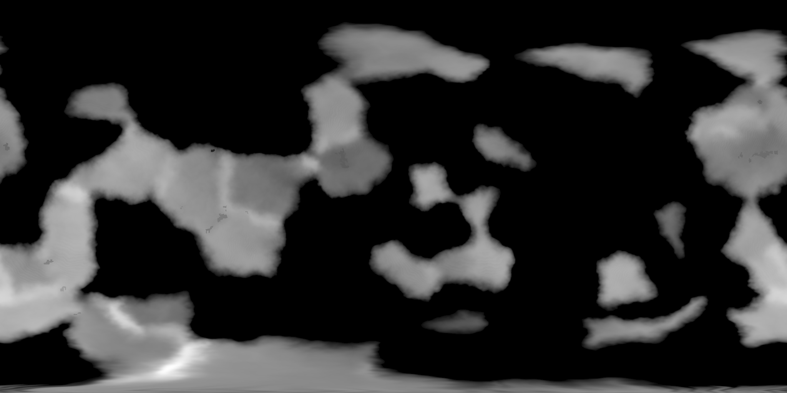
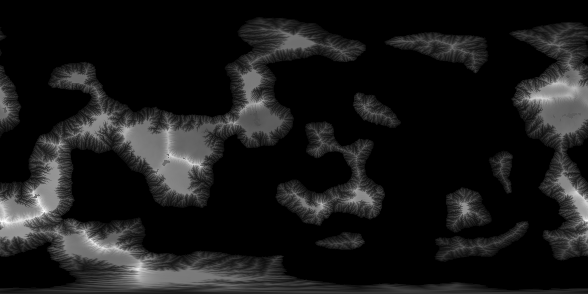
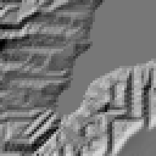
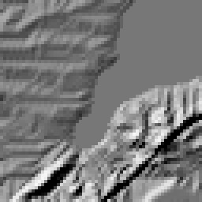

# Planet generator baseline

Phase 0 of [planet-generator-geology-erosion-plan.md](planet-generator-geology-erosion-plan.md),
measured 2026-08-17. This is the reference every later phase is judged against.
Nothing here proposes a change; it records what the generator costs and what it
produces today, at the world scale we are actually building.

The world scale changed with this measurement: the target is a **200 km-diameter
planet, radius 100 km** — 628 km circumference, 125,664 km² of surface, of which
51,565 km² came out as land (41%).

## Reproducing it

```sh
scripts/planet-baseline.sh <output-root> 3 100000      # three runs per resolution
scripts/planet-diagnostics.py <output-root>/planet-2048x1024-run1
```

The reference planet is frozen as **seed 9127364512, radius 100 km**, at
2048×1024 and 4096×2048. `planet-baseline.sh` writes `planet-profile.json` per
run; `planet-diagnostics.py` writes `summary.json`, four CSVs, `plots.svg`, and
`heightmap.png`. Both are checked in, and the reference artifacts live in
[docs/planet-baseline/](planet-baseline/).

## Noise floor

Measured first, because prior performance work on this engine was voided by a 3×
run-to-run variance nobody measured. Three runs per resolution, same seed,
otherwise idle machine (10-core Darwin, Release build):

| resolution | total, mean | min | max | spread |
|---|---|---|---|---|
| 2048×1024 | 4269 ms | 4234 ms | 4323 ms | **2.1%** |
| 4096×2048 | 7509 ms | 7234 ms | 8021 ms | **10.5%** |

Per-stage spread is wider than the total's and is what actually bounds a claim
about one stage. The worst offenders: `rasterClimate` 69.9% at 4096×2048,
`rasterStructure` 22.1%, `graphMesh` 21.4%, `graphSurface` 26.7% at 2048×1024.

**Gate for later phases: at 4096×2048, a total-time change under ~10% is noise,
and a single-stage change under ~25% is noise unless it is re-measured with more
runs.** At 2048×1024 the total is tight enough to trust a 3% change.

## Where the time goes

Mean of three runs. The graph sub-stages do not sum to `graph total`;
bookkeeping between them is unattributed.

| stage | 2048×1024 | % | 4096×2048 | % |
|---|---|---|---|---|
| graph mesh | 667 ms | 15.6 | 686 ms | 9.1 |
| graph fields | 969 ms | 22.7 | 989 ms | 13.2 |
| graph erosion | 524 ms | 12.3 | 512 ms | 6.8 |
| graph climate | 818 ms | 19.1 | 841 ms | 11.2 |
| graph rivers | 226 ms | 5.3 | 221 ms | 2.9 |
| graph surface | 36 ms | 0.8 | 31 ms | 0.4 |
| graph rasterize | 12 ms | 0.3 | 12 ms | 0.2 |
| **graph total** | **3251 ms** | **76.1** | **3291 ms** | **43.8** |
| macro blur | 6 ms | 0.1 | 5 ms | 0.1 |
| raster structure | 271 ms | 6.4 | 1006 ms | 13.4 |
| raster coast | 32 ms | 0.8 | 131 ms | 1.7 |
| raster mountain | 16 ms | 0.4 | 188 ms | 2.5 |
| raster climate | 115 ms | 2.7 | 585 ms | 7.8 |
| raster routing | 513 ms | 12.0 | 2126 ms | 28.3 |
| raster erosion | 27 ms | 0.6 | 87 ms | 1.2 |
| raster classify | 16 ms | 0.4 | 63 ms | 0.8 |
| **total** | **4269 ms** | **100** | **7509 ms** | **100** |

The graph is resolution-independent (3.25 s at both) because it is generated at a
capped macro resolution of 512 wide with a fixed 204,001 regions. Everything that
grows with resolution is in the raster half.

Three things in this table matter for the plan:

**`erodeSphericalRasterMaps` costs 27 ms — 0.6% of generation.** Phase 1 deletes
it. That deletion frees no meaningful budget, so GPU stream power erosion must be
justified as new spend for a better field, not as a swap. The plan's phase-1 gate
3 ("total generation time does not regress") should be read with this in mind:
there is nothing to trade against, and the honest framing is a stated new cost.

**`routeRainfallRunoff` costs 513 ms at 2048 and 2126 ms at 4096 — 12% and 28%,
run twice.** It is 19–24× the cost of the erosion it feeds. The plan notes in
passing that phase 3 makes routing redundant because drainage area `A` is a
strictly better discharge proxy than a re-routed river mask; that is now a
measured 2.1 s at 4096×2048, and it is the budget the GPU solver can be paid for
out of.

**The graph's own erosion (`erodeSphericalGraph`, 524 ms) is 19× the raster
erosion pass.** D2 keeps it as the CPU parity reference. It is not free, and if
phase 1 subsumes it later that is another 0.5 s.

## What the generator produces

Reference planet, 2048×1024, seed 9127364512, R=100 km:

| metric | value |
|---|---|
| land fraction | 0.410 (51,565 km²) |
| relief | 162.8 m |
| median land elevation | 84.5 m |
| median slope | 0.0037 (0.21°) |
| max slope | 1.64 (58.6°) |
| max drainage area | 2,341 km² (4.5% of land) |
| depression (pit) cells | 5,592 — 0.68% of land |
| channel-regime θ | **−0.29, r² 0.34** |
| biome boundary cells | 22.0% of land |

At 4096×2048 every one of these is within noise of the 2048 figures: land
fraction 0.410, relief 162.9 m, median slope 0.0037, θ −0.23 r² 0.32, max
drainage 2,392 km². **Doubling the raster resolution adds no relief information
— it resamples the same macro field.** That is expected given the graph is
capped at 512 wide, and it means resolution is not a quality dial today.



The height field is the clearest statement of the problem. Continents are flat
plateaus with **visible Voronoi region facets** — piecewise-constant elevation
patches with the graph's polygon boundaries showing as steps. There is no
drainage network: no dendritic valley pattern, no ridge lines, nothing that
reads as carved. The bright smear along the bottom row is the equirectangular
pole, which D1 retires by moving the solver to cube faces.


### The slope–area relation

This is the diagnostic that says whether a fluvial model is doing anything real.
A converged stream-power field breaks cleanly into a hillslope regime at small
drainage area and a channel regime where slope falls as a power law in area,
θ ≈ −0.4 to −0.6 with a tight fit.

What the current field gives is θ = −0.29 with **r² = 0.34** above the 1 km²
channel-initiation threshold. There is a weak negative trend, but the power law
explains a third of the variance: the relation is a U-shaped wobble, not a
regime. Slope falls from 3.2×10⁻² at 190 m² to 1.7×10⁻³ at 1.2×10⁵ m², then
*rises* back to 7.4×10⁻³ at 10⁶ m² before falling again. Ground gets steeper as
catchments grow through the middle of the range, which is backwards.

That is what the plan predicted: incision keyed off a river mask
(`smoothstep((river − 0.035) / 0.70)`) rather than off drainage area cannot
produce a slope–area relation, because it never looks at area.

**Phase-1 gate, stated numerically: θ ∈ [−0.6, −0.4] with r² ≥ 0.8.**

### Depressions

5,592 land cells have no downhill neighbour. Before I added priority-flood
filling to the diagnostics, those pits swallowed **17,654 km² of 51,565 km² —
34% of the land's drainage never reached the sea**, and max drainage area read
370 km² instead of 2,341 km². The tool now fills depressions before routing;
the pit count is reported as a metric because SPE's `z = max(z, z_receiver)`
makes pits impossible by construction, so phase 1 should drive this to zero.

### Land cover is not a biome distribution

Two classes are 57% of all land, and the substrate classes are never emitted at
all:

| cover | share of land |
|---|---|
| Shrubland | 32.99% |
| TemperateDesert | 24.41% |
| Ice | 12.54% |
| SubtropicalDesert | 10.26% |
| Tundra | 8.94% |
| River | 4.41% |
| Beach | 3.90% |
| Grassland | 1.34% |
| TropicalSeasonalForest | 0.52% |
| Lake | 0.32% |
| TemperateDeciduousForest | 0.14% |
| TropicalRainForest | 0.11% |
| Marsh | 0.05% |
| TemperateRainForest | 0.04% |
| Taiga | 0.02% |

**`Grass`, `Rock`, `Snow`, `Bare`, and `Scorched` are 0 cells.** Of the 21
values in `PolygonTerrainMaterial`, 5 are dead and 6 more are below 1.5%. All
forest classes together are 0.83% of land. The world is a shrub desert with ice
caps.

This reframes the "better biome transitions" goal. The transitions are hard
steps — 22.0% of land cells sit on a cover boundary, every one a discrete jump
between palette entries — but the distribution behind them is the larger
problem, and `Rock`/`Bare` being unreachable is why no rock is visible anywhere
on the surface today. Both are inputs to the surface-cover work rather than
things phase 1 or 2 fix on their own.

## Phase 1 result: GPU stream power erosion

Landed 2026-08-17. `erodeSphericalRasterMaps` is deleted; all fluvial and
hillslope relief now comes from `PlanetStreamPowerSolver` running on six cube
faces. Same reference planet, seed 9127364512, R=100 km, 2048×1024 atlas →
512-cell faces, 1024 iterations.

| gate | requirement | result |
|---|---|---|
| D3 determinism | bit-exact across two runs of one seed | **pass** — `heightmap.pgm`, `material-map.pgm`, `river-map.pgm` and `planet.planetpkg` all hash identical |
| slope–area | clean hillslope/channel break | **pass** — θ = **−0.478**, r² = **0.997** |
| generation time | no regression, or an honest statement of the new cost | **new cost stated below** |

### Cost

Three runs at 2048×1024: total 6228 / 6251 / 6238 ms — a 0.4% spread. Against
the 4269 ms baseline that is **+1.97 s, +46%**, of which the solver is 2.17 s
(2.06 s solve, 0.11 s projection and readback) at 1,572,864 cells × 1024
iterations.

The deleted CPU pass cost 27 ms. There was nothing to trade against, so this is
new spend, not a swap: **converged fluvial relief now costs about 2.2 s.** The
2.1 s of `routeRainfallRunoff` identified in the baseline is still on the table
to pay for it, since the solver's drainage field is a strictly better discharge
proxy than the re-routed mask.

### Measure θ on the cube domain, not the atlas

The same planet measured both ways gives **θ = −0.478 (r² 0.997) on the cube
faces and θ = −1.12 (r² 0.64) on the exported equirectangular atlas.** The atlas
is wrong, not the terrain: its rows narrow to nothing at the poles, so thousands
of texels cover one cube cell and report enormous drainage at near-zero slope,
which drags the high-area end of the curve down and steepens the fit. Max
drainage reads 725 km² on the cube domain and 1757 km² on the atlas for the same
field.

Use `scripts/planet-cube-diagnostics.py` on the `planet-erosion-field.bin` the
bake now writes. `scripts/planet-diagnostics.py` remains correct for everything
that is genuinely an atlas property — land fraction, relief, hypsometry, cover
distribution.

### Calibration

Reference-GLSL exponents are kept (`m = 0.8`, `n = 2`); the WebGPU port's `n = 1`
is a concession to its 8-bit height field and materially weakens valley
deepening. Everything else had to be recalibrated, because the reference's
constants belong to a few-hundred-cell patch whose drainage is counted in cell
diagonals:

- **`k = 2.5e-5`** with drainage area in **square metres**. The reference's
  `k = 0.0005` over cell-counted area is about four orders of magnitude too
  strong here. Area in m² rather than cells is what makes `k` mean the same
  thing at every bake resolution.
- **`upliftRate = 0.10`**. Stream power balances uplift at
  `S = (U/(k·A^m))^(1/n)`, so this pair sets the equilibrium channel slope, and
  it is the single most consequential dial. At zero uplift the channels flatten
  the authored relief to 1279 m; at 0.10 the run holds 1904 m → 1956 m.
- **`simulatedTime = 12800`**, divided by the iteration count to get the step.
  A fixed per-iteration step makes a higher-resolution bake erode proportionally
  more; that alone moved θ from −0.50 at 256 iterations to −1.12 at 1024.

Two defects found by calibration, both worth knowing about:

- **The height encoding has a 0.025 pedestal.** `encodedLandElevation` starts
  land at 0.025 of the range and `decodedLandElevation` maps anything below it
  back to zero, which material classification reads as ocean. Before the solver
  respected that pedestal it silently drowned coastline: land fraction fell from
  0.411 to 0.317. With the clamp it holds at 0.406, and the remaining loss is
  genuine coastal erosion.
- **Eight storage-buffer bindings in one group did not all arrive.** Bindings 6
  and 7 read as zeros and one write target was dropped, with correct SPIR-V,
  correct uploads, distinct buffers and clean validation layers. Packing the
  per-cell fields into a struct and ping-ponging two state buffers — which is
  what the reference does with its `vec4` Read/Write pair — cut the set to four
  bindings and fixed it. The uplift term had been inert until then.

### Iteration count is converged at 2 × side

The plan's rule is to iterate until the channel-regime slope stops moving.
It has stopped by 1024:

| iterations | θ | median slope | solve |
|---|---|---|---|
| 1024 | −0.478 | 0.2304 | 2.06 s |
| 2048 | −0.473 | 0.2305 | 4.07 s |
| 4096 | −0.472 | 0.2308 | 7.98 s |

θ moves 0.006 across a fourfold increase, so `2 × side` stays the default and
longer runs buy nothing.



Against the baseline image earlier in this document, the change is the whole
point of the phase: dense dendritic drainage networks, ridge lines between
catchments, and coastal escarpments, in place of flat Voronoi-faceted blobs.

**The continental interiors stay as plateaus, and that is equilibrium rather
than an unfinished run** — the iteration table above is the evidence. Stream
power incision is proportional to S², so a surface with no gradient erodes at no
rate: dissection can only advance headward from the coast into the plateau edge.
Partly dissected uplands with steep margins are a real landform pattern, and
phase 2's varying erodibility will break the remaining uniformity, but if fully
dissected interiors are wanted, the lever is initial roughness or interior
uplift, not more iterations.

### What phase 1 does not do

`routeRainfallRunoff` still runs twice, and the solver's drainage field is
written to disk for diagnostics but not yet consumed by material classification.
Erodibility is still uniform, so there are no cliffs, benches or caprock — that
is phase 2, and it is where the terrain starts reading as geology rather than as
a smooth solved surface.

## Phase 2 result: lithology and differential erosion

Landed 2026-08-17. `src/runtime/procedural/PlanetGeology.hpp` defines eight rock
types with erodibility, talus angle, regolith yield and an albedo/roughness
pair; the solver reads erodibility per cell, and the package carries a new
`PlanetRasterChannel::Lithology`.

| gate | result |
|---|---|
| cliffs and benches obvious vs uniform k | **pass** — see the comparison below |
| determinism preserved | **pass** — heightmap, materials and package still bit-identical across runs |
| package validity | **pass** — 52 channels, 603 blocks, external validation clean |

| uniform k | varying k |
|---|---|
|  |  |

Same 64-cell window (20 km across, 307 m cells), same sun, 4× magnified. The
uniform run dissects evenly everywhere. The varying run has hard shadow lines —
escarpments where a resistant bed outcrops — and smooth benches between them.

**This only reads at the right zoom.** A stratum 210 m thick outcrops across
about three cells on a 0.2 slope, so at planet scale every bench is sub-pixel
and the two runs look identical. `scripts/planet-hillshade.py` renders a window
of the cube field for exactly this reason; judging landforms on a whole-planet
image is judging the resampling.

### Stratigraphy is a function of height, not a baked byte

The first version stored one rock index per texel, classified from the
pre-erosion surface. It produced almost no visible landforms, and the reason is
worth keeping: **a valley that cut 500 m down still carried the rock type of the
surface it started from.** Real beds are fixed in space; the surface moves
through them.

So the generator now stores a `PlanetRockSuite` (Oceanic, Basement, Platform,
Volcanic) plus a bedding phase, and `planetStratumLithology` resolves suite plus
*current* height to a rock type. The solver re-evaluates it every iteration, so
incision exposes the bed beneath as it cuts and a resistant bed becomes a bench
where the surface arrives at it. The same query answers "what is under this
voxel", which is what phase 4 needs for a dug column.

Suite and bedding phase ride in bits 8–11 and 16–23 of the cell's existing flag
word, so the 16-byte GPU cell did not grow.

### The erodibility table is normalized to a geometric mean of 1

The first table ran from 1.0 for shale down to 0.07 for granite — every rock at
or below 1. That silently divides the global erosion rate by the table's own
mean, leaving uplift unopposed: peak relief went straight to the 3000 m encoding
ceiling and stayed clamped. Renormalizing to a geometric mean of 1 (shale 2.92,
granite 0.20, same 15× contrast) fixed it.

Uplift also had to come down from 0.10 to **0.05**, because resistant rock
amplifies relief. Final reference planet: relief 2418 m, θ = **−0.492**,
r² = **0.995**.

### What the ground is made of

All eight rock types are exposed on the reference planet:

| rock | share of land | | rock | share of land |
|---|---|---|---|---|
| Limestone | 31.96% | | Basalt | 3.83% |
| Sandstone | 31.28% | | Granite | 3.58% |
| Shale | 14.24% | | Volcanic | 2.30% |
| Sedimentary | 11.73% | | Metamorphic | 1.07% |

Platform sediments dominate at 89% and basement rock is 5%, which is what a
world with small mountain belts should look like. Note this is *substrate*: the
surface-cover distribution from phase 0 — two classes covering 57% of land, five
classes never emitted at all — is untouched, and remains the biome work.

## Phase 3 result: regolith and sediment — partial

Landed 2026-08-17, **opt-in and not calibrated**. The default remains
detachment-limited stream power; `--sediment-transport` selects the
transport-limited path. Two things from this phase are on by default because
they are fixes rather than features, and they changed the phase-1/2 numbers.

### Two defects found, both now fixed

**`incise_main` was discarding the accumulation it had just been given.** It
started its cell from `stateIn`, which meant the drainage and sediment
`accumulate_main` wrote into `stateOut` were overwritten by the previous
iteration's values every step. Drainage still grew — through the ping-pong, at
half rate — which is why nothing looked wrong. Starting from `stateOut` instead
raised the reference planet's largest catchment from 650 km² to **8,395 km²** on
51,000 km² of land, which is what a major river basin should be.

This moves the phase-1 and phase-2 headline: on the corrected accumulation the
reference planet measures **θ = −0.362 with r² = 0.994**, against −0.492/0.995
before. The fit is still a clean power law — r² is unchanged — but the exponent
is shallower now that drainage area is resolved properly. θ ≈ 0.36 sits inside
the 0.3–0.7 range real landscapes span, so this is a better number from a better
measurement, not a regression.

**Accumulation can compound once deposition exists.** Phase 1's carry-forward
scheme assumes the surface strictly decreases along every receiver, which the
monotonicity clamp guarantees. Deposition breaks that: a filled cell can rise
above its former donor, the flow direction flips between iterations, and a value
that already contains a region's drainage gets fed back into that region. One
interior cell reached **2.57× the planet's entire land area**. Drainage is now
bounded by total land area, which is a physical bound and not a fix — the
underlying scheme is what needs revisiting if transport-limited erosion is to
ship.

### Mass balance closes to 7.6%, with the residual named

`--closed-system` removes the ocean outlet so conservation can be checked for
real. With an outlet the export term is inferred — it is whatever did not become
regolith — so it cannot detect its own error.

| term | closed-system run |
|---|---|
| bedrock lost | −1.63×10¹² m³ |
| uplift source | 5.39×10¹² m³ |
| clamp injected | 7.11×10¹⁰ m³ |
| regolith gained | 3.09×10¹² m³ |
| in transit | 3.28×10¹¹ m³ |
| **residual** | **7.6%** |

Getting there required accounting for three things the first version hid: the
monotonicity clamp inventing rock (now filled from sediment first, and the
remainder counted), the land pedestal raising cells eroded below it, and
sediment still in flight when the run stops. Hillslope creep was measured and
ruled out as a contributor: 0.106 residual with diffusion off against 0.101 with
it on.

The remaining 7.6% is not accounted for. It is small enough not to show in a
render and large enough to matter over a long run, which is exactly the case the
plan warned about.

### Why it is off by default

Turned on, the transport-limited path flattens the planet: median slope 0.0005,
θ = +0.13, r² = 0.25. Capacity is `kt·A^m·S^n` and erosion is capacity minus
load, so where load is small and capacity large the flow erodes to the receiver
level immediately. It needs its own calibration of `transportK`, `weatheringRate`
and `depositionK` — the phase-1 constants are not transferable, exactly as the
phase-1 constants were not transferable from the reference solver.

So the gate — fans, valley fill, deltas, and a closing mass balance — is **not
met**. What exists is the machinery: bedrock and regolith tracked separately,
weathering with depth-armouring, sediment routed along the receiver chain,
deposition above capacity, incision reaching bedrock only when regolith is
exhausted, and instrumented mass accounting.

## Runtime landforms: rocks, terraces and gullies

Landed 2026-08-17. The bake resolves 307 m cells, so everything a person stands
next to — ledges, boulders, scree, gully walls — is below it and has to be
generated at chunk-build time or it does not exist. `proceduralTerrainDetail`
already did this with noise; what it lacked was any idea what the ground was
made of.

**Its rock behaviour had never once executed.** The `exposedRock` branch keyed
off the `Rock`, `Bare`, `Scorched` and `Snow` *cover* classes — and phase 0
measured those at exactly zero cells on every planet this generator makes. The
one path meant to produce visible rock was unreachable from the day it was
written.

It is now driven by the `Lithology` channel, which does vary and which every
rock type reaches. Measured over a 900 m ground transect at 9 m spacing:

| rock | height range | steepest step | abrupt steps (>3 m) |
|---|---|---|---|
| Shale | 30.1 m | 13.4 m | 15 |
| Sedimentary | 30.2 m | 13.6 m | 14 |
| Limestone | 28.4 m | 13.4 m | 13 |
| Sandstone | 28.3 m | 13.0 m | 14 |
| Volcanic | 20.9 m | 4.7 m | 11 |
| Basalt | 20.7 m | 6.4 m | 11 |
| Metamorphic | 20.7 m | 8.6 m | 11 |
| Granite | 20.3 m | **14.3 m** | **6** |

Two distinct signatures, which is the point: layered rock produces *many*
medium risers — a benched, stepped landscape — while granite produces the
tallest features but only six of them, isolated, with open ground between. That
is a boulder field rather than a rough surface.

What generates them:

- **Bedding terraces** on layered rock, by quantizing accumulated relief into
  14–36 m beds with an eased riser in the top fifth. This is the runtime echo of
  the stratigraphy the solver eroded differentially at bake scale. Bed thickness
  is a property of the sequence, not of how hard one bed is: a terrace forms
  from the contrast between a resistant bed and the weak one beneath, which is
  why sandstone holds ledges despite sitting mid-table on absolute erodibility.
- **Tors and boulder fields** on resistant rock, by thresholding noise at 0.86
  and easing the remainder. The threshold is what makes them objects: at 0.68
  roughly a third of the ground was raised and it read as generic lumpiness.
- **Gullies**, a narrow incision along the ridge network's inverse, cutting the
  V-shaped side valleys the 307 m bake cannot resolve. These deepen with *weak*
  rock, so they scale against resistance rather than with it.
- **Ridge sharpness** rising with resistance, so a granite range keeps an edge
  where a shale one is already a rounded hill.
- **Scree** below standing rock, smooth and low-frequency because a talus slope
  is graded, supplied more heavily by weak rock.

The channel is optional throughout: packages written before it existed load with
the neutral default rather than failing.

## The planet view: what reaches the screen

Two paths render this planet, and only one of them saw the landform work.

**Voxel chunks** (near field) read the `Lithology` channel and run the full
landform generator at voxel resolution. This path is complete.

**The CBT globe** displaces its adaptive triangles by sampling a baked surface
atlas, so it only ever shows what that atlas resolves. Two problems, both fixed:

- The overview never read lithology at all, so every texel was generated as the
  default rock.
- Adding the `lithology` parameter ahead of the existing defaulted `strength`
  silently rebound both call sites — `planetVoxelTerrainDetail(..., material,
  2.0)` passed 2.0 as *rock type* (limestone), and strength fell back to 1.0. A
  double-to-uint8_t narrowing is legal in a call, so nothing failed to compile.
  `strength` is back in its original position with `lithology` after it.

### Atlas resolution, measured

Six faces at 12 bytes a texel (4 albedo, 4 features, 2 height, 2 ocean floor),
generation timed on the reference planet:

| face resolution | generation | atlas | texel at R=100 km |
|---|---|---|---|
| 512 | 411 ms | 18 MB | 307 m |
| 1024 (previous default) | 1,137 ms | 72 MB | 153 m |
| **2048 (current default)** | **4,260 ms** | **288 MB** | **77 m** |
| 4096 | ~17 s | 1.15 GB | 38 m |

2048 is the clamp: 4096 costs over a gigabyte before mips. Generation is now
threaded one cube-face row per work item, each worker holding its own
`RasterSampler` because the sampler memoizes decompressed tiles in a `std::map`.
Serial, 2048 would have taken roughly 40 s of planet load.

### Resolution is not the answer to zoom

At 2048 a texel is 77 m, still above the 14–36 m bedding terraces and the 38 m
boulder spacing the landform generator produces. Meanwhile the CBT subdivides to
depth 24, which on this planet is a **26 m triangle**. So geometry already
resolves three times finer than the height field it displaces by: zoom in and
subdivision adds triangles that all sample the same texel.

Closing that gap means evaluating the landform noise **per vertex on the GPU**
rather than sampling a baked atlas, which makes subdivision keep producing new
relief without bound. The obstacle is not the noise stack but its hash: the CPU
uses 64-bit splitmix mixing, WGSL has no u64, and an inexact port makes the CBT
surface and the voxel chunks disagree — a visible pop exactly at the transition
the zoom passes through. An exact port needs u64 emulated as a u32 pair, and it
needs a test comparing GPU output against `smoothNoise3D` before it is trusted.

## Determinism: broken by phase 3, fixed

The D3 gate passed after phases 1 and 2, was not re-run while three phases of
kernel changes landed, and had silently broken by the time it was checked again:
**17.2% of cells differed between two runs of one seed, by up to 1,856 m.** Two
independent causes, both now fixed, and the reference planet hashes identically
across three consecutive runs — heightmap, materials, lithology, rivers, package
and mesh.

### The uniform buffer layout had drifted

WGSL gives `array<vec4<f32>, 2>` a 16-byte alignment, so the shader read
`erodibility` at offset **96**. The C++ `std::array<float, 8>` sat at offset
**88**. Every rock therefore took another rock's erodibility, and the last two —
metamorphic and granite, the rocks mountains are made of — read **struct
padding**.

Phase 2 was correct by luck: its scalars totalled exactly 64 bytes, which is
already 16-aligned. Phase 3 added six more scalars, pushed the total to 88, and
broke it with no compiler anywhere able to notice.

The fix is explicit padding plus the assertions that should have been there from
the start:

```cpp
static_assert(sizeof(Uniforms) == 128u, ...);
static_assert(offsetof(Uniforms, erodibility) == 96u, ...);
```

This was not only a determinism bug. Correcting it moved the channel-regime
exponent from −0.362 to **θ = −0.532 at r² 0.996**, because the most resistant
rocks finally resist.

### The biome classifier raced on its own input

The classification loop writes `maps.heightmap[cell] = 0` for every cell it
decides is ocean, while neighbouring rows are classified in parallel. The new
slope term read those same neighbour heights, so a thread could sample a height
that another thread was zeroing. Slope is now computed in a pre-pass over an
unmodified surface.

### What to take from it

Determinism was verified once and then assumed for three phases. It is cheap to
check — three runs and a hash — and it is the only gate that catches a uniform
layout drifting out from under a shader. Run it on every change to the solver or
to the classification, not once per project.

## Method notes and limits

- Timings come from `SphericalTerrainProfile`, populated inside
  `SphericalTerrainGenerator::generate` and printed by `--headless`. They cover
  generation only: package writing and mesh export add ~3 s of wall clock that
  this table deliberately excludes.
- Diagnostics are computed on the exported equirectangular `heightmap.pgm`, so
  cell area is `cos(latitude)`-weighted and neighbour lookups reflect across the
  poles the way `atlas_coord` does. Hypsometry is area-weighted for the same
  reason.
- Drainage area is computed by the diagnostics tool, not read from the export:
  the generator never produces it. Depression filling uses priority flood with a
  0.1 mm epsilon gradient, four orders of magnitude below the median slope.
- Relief is capped by the package encode at 256 m
  (`max(heightRangeMetres, radius × 0.0015)` = max(256, 150) at R=100 km), and
  the field reaches 162.8 m of that. A 200 km-diameter world with 163 m of total
  relief is nearly flat; whether that is the intended look is a separate
  decision from anything in this document.
